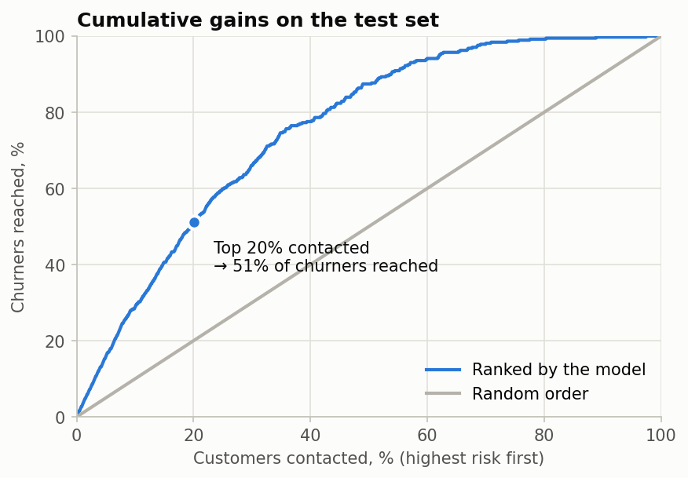
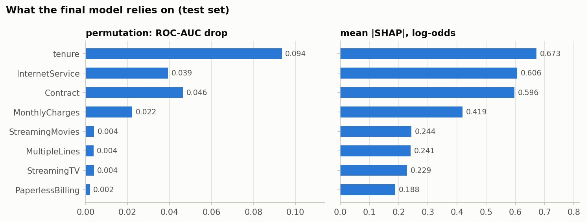

# Customer Churn Prediction

Predicts which telecom customers will leave, explains why, and serves the model through a REST API.

**Data:** [IBM Telco Customer Churn](https://www.kaggle.com/datasets/blastchar/telco-customer-churn): 7,043 customers, 26.5% of them churned.

## Results

Models compared with repeated stratified 5-fold cross-validation (3 × 5 = 15 folds) on the training set:

| Model | ROC-AUC (CV) | PR-AUC (CV) |
|---|---|---|
| **Logistic regression + log(tenure)**, served | **0.850 ± 0.011** | 0.673 |
| LightGBM | 0.848 ± 0.011 | 0.668 |
| Random Forest | 0.847 ± 0.010 | 0.665 |
| CatBoost | 0.846 ± 0.011 | 0.666 |
| Logistic regression, raw features | 0.845 ± 0.010 | 0.659 |

Logistic regression matches the boosted trees once tenure is log-transformed (churn risk falls steeply in the first months), and it stays interpretable. On the held-out test set (1,409 customers) it reaches **ROC-AUC 0.848**.

**For a retention team:** contacting the **20% highest-risk customers reaches 51% of all churners**, against 20% with random targeting.



## What drives churn

Permutation importance and SHAP, both computed on the served model, agree: **tenure, contract type and internet service** carry most of the signal.

- 61% of customers with one month of tenure or less leave; after five years, 7% do.
- Month-to-month customers churn at 43%, against 11% on one-year and 3% on two-year contracts.
- Fiber-optic customers churn at 42%, against 19% on DSL.

An earlier version of this project named TotalCharges and MonthlyCharges as the top predictors. That ranking came from Random Forest impurity importance, which favors continuous features. Measured on held-out data, the same forest ranks them 6th and 11th. Details are in [`notebooks/02_modeling.ipynb`](notebooks/02_modeling.ipynb), section 4.



## Run the API

```bash
pip install -r requirements.txt
python train.py                  # trains, evaluates, saves models/churn_model.joblib
uvicorn app.main:app --reload    # interactive docs at http://127.0.0.1:8000/docs
```

```bash
curl -X POST http://127.0.0.1:8000/predict -H "Content-Type: application/json" -d '{
  "gender": "Female", "SeniorCitizen": 0, "Partner": "No", "Dependents": "No", "tenure": 3,
  "PhoneService": "Yes", "MultipleLines": "No", "InternetService": "Fiber optic",
  "OnlineSecurity": "No", "OnlineBackup": "No", "DeviceProtection": "No", "TechSupport": "No",
  "StreamingTV": "Yes", "StreamingMovies": "No", "Contract": "Month-to-month",
  "PaperlessBilling": "Yes", "PaymentMethod": "Electronic check", "MonthlyCharges": 85.5}'
```

```json
{"churn_probability": 0.7828, "high_risk": true, "threshold": 0.3446}
```

The API takes raw values, as they appear in the dataset. Pydantic rejects unknown categories and out-of-range numbers with HTTP 422. Encoding and scaling live inside the saved scikit-learn pipeline, so serving always matches training. `high_risk` uses the F1-optimal threshold, chosen on out-of-fold training predictions.

**Docker**

```bash
docker build -t churn-api .
docker run -p 8000:8000 churn-api
```

**Tests and CI.** `pytest` checks input validation, sanity cases, and that the API reproduces the pipeline's predictions on real rows. GitHub Actions trains the model, runs the tests, builds the image and smoke-tests the container on every push.

**Experiment tracking.** The notebook logs every model comparison to MLflow; `python train.py --mlflow` logs the final run and model. Browse them with `mlflow ui --backend-store-uri sqlite:///mlflow.db`.

**Deploy.** On [Render](https://render.com/docs/web-services), create a Web Service from this repository; it builds the Dockerfile, and the container listens on the `$PORT` Render provides. Free instances sleep after 15 minutes without traffic, so the first request after a pause takes about a minute.

## Project structure

```
churn-prediction/
├── app/main.py             # FastAPI service
├── churn/pipeline.py       # data loading + model pipeline shared by training, notebook and API
├── train.py                # train, evaluate, pick threshold, save model (+ optional MLflow run)
├── tests/                  # pytest: API, validation, train/serve consistency
├── notebooks/
│   ├── 01_eda.ipynb
│   └── 02_modeling.ipynb   # model comparison, interpretation, business view
├── data/                   # dataset and charts
├── Dockerfile
├── .github/workflows/ci.yml
├── requirements.txt        # runtime and training
└── requirements-dev.txt    # notebooks, model comparison, MLflow, tests
```

## Tech stack

Python · pandas · scikit-learn · LightGBM · CatBoost · SHAP · MLflow · FastAPI · pydantic · pytest · Docker · GitHub Actions
